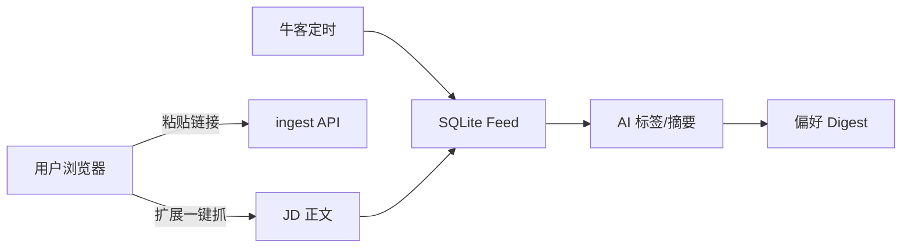

# ResumeAI 爬虫架构 Brainstorm

> 在「合规公开页 + 校招垂直」约束下，什么方式比现在的 Playwright 全站扫更靠谱？

## 现状（Tier L1–L4）

```
YAML 配置源 → Playwright/httpx 抓列表 → 规则解析 → 校验 → AI 兜底 → SQLite
```

**优点**：零合作成本、可自托管、牛客日程质量高。  
**缺点**：慢（全量 ~28min）、高校 generic_list 噪声、robots 误拦、资讯/岗位难区分。

---

## 方案对比

| 方案 | 质量 | 成本 | 合规 | 实现难度 | 推荐度 |
|------|------|------|------|----------|--------|
| **A. 精选源 + 专用解析器**（当前强化方向） | 高 | 低 | 高 | 中 | ★★★★★ |
| **B. 用户粘贴 URL / 浏览器扩展抓 JD** | 极高 | 低 | 最高 | 中 | ★★★★☆ |
| **C. 牛客/企业 API 或移动端接口** | 高 | 低 | 需确认 ToS | 高 | ★★★★☆ |
| **D. RSS / 官方 JSON 接口** | 高 | 极低 | 高 | 低（若有） | ★★★★★ |
| **E. 人工 curated + AI 清洗** | 极高 | 中 | 高 | 低 | ★★★☆☆ |
| **F. 全站 Playwright 扫**（旧默认） | 低~中 | 高 | 中 | 已有 | ★★☆☆☆ |
| **G. OfferShow/BOSS 逆向** | 中 | 高 | 差 | 极高 | ✗ |

---

## 推荐演进路线

### 阶段 1（已做）：止血

- 下线低 ok 率源（牛客热门、24365、北京高校网 generic）
- 高校默认 `ignore_robots`、微信域名 bypass
- 资讯标题规则 + AI 门控批处理
- 分 provider 错峰定时任务；前端「刷新」优先牛客+企业

### 阶段 2：结构化优先

**原则：能 API 不 HTML，能详情不列表。**

1. **牛客**：抓 `enterprise/{id}` 详情（已做），调研是否有公开 JSON schedule API
2. **字节等**：已有 `bytedance_campus` 专用解析，推广到阿里/腾讯职位 API
3. **高校**：每校一个 `parser: tsinghua_list` 而非 `generic_list`（维护 10 所核心校即可覆盖 80% 用户）

### 阶段 3：用户参与采集（质量最高）



- **浏览器扩展**：在 BOSS/官网 JD 页提取正文 → `POST /api/jobs/ingest`（不爬列表，合规）
- **公众号**：仅用户粘贴 `mp.weixin.qq.com` 链接（已支持 robots bypass）
- **牛客订阅**：用户关注公司 → 只抓这些 enterprise 详情

### 阶段 4：智能层（低成本 AI）

| 环节 | 做法 | Token |
|------|------|-------|
| 脏行解析 | weak 批处理 extract | ~10条/次 |
| 打标签 | ok 批处理 tag | ~20条/次 |
| 资讯判别 | 规则优先，AI 仅 weak | 极少 |
| Digest 精排 | Top15 rerank | 1次/天 |

**不做**：全量 JD embedding、每条岗位都调 LLM。

---

## 替代数据源调研

| 来源 | 可行性 | 说明 |
|------|--------|------|
| 牛客校招日程 | ✅ 已用 | 最佳公开源 |
| 应届生求职网 | ✅ 已用 | 需 ignore_robots |
| 企业校招官网 | ✅ 已用 | 慢但准 |
| 24365 | ⚠️ 暂停 | 资讯多，需官方 API |
| 北京高校网 | ⚠️ 暂停 | 活动通知多 |
| OfferShow | ❌ | App+登录，无稳定公开页 |
| 猎聘/BOSS 列表 | ❌ | 明确禁止 + 反爬 |
| 飞书秋招表 | ❌ 已移除 | 渠道失效 |
| 内推星球/知识星球 | ⚠️ | 付费墙，不适合爬 |

---

## 产品层配合

1. **双按钮**：「快速刷新」（牛客+企业，~3min）/ 「全量刷新」（含高校，~15min）
2. **源质量徽章**：岗位列表展示 channel + validation_status
3. **反馈闭环**：用户标记「这不是岗位」→ 写入 blocklist 训练规则
4. **Digest 驱动**：弱源降权，牛客 P0 优先展示

---

## 结论

> **更好的爬虫 ≠ 爬更多站，而是爬得更准、更新更勤、噪声更少。**

短期：**牛客日程 + 企业官网 + 规则/AI 过滤** 是 ROI 最高的组合。  
中期：**用户主动 ingest（扩展/粘贴）+ 每校专用解析器**。  
长期：若拿到合作 **官方 API 或 RSS**，可替换 80% Playwright 流量。
