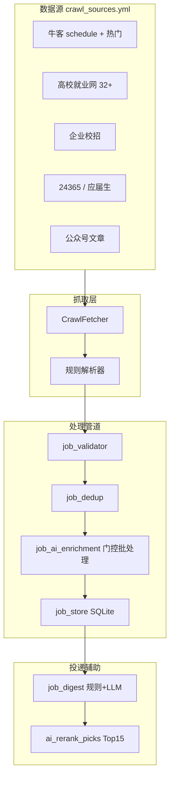

# ResumeAI 爬虫与岗位数据优化方案

> 版本：2026-06 | 状态：已落地核心实现

## 1. 背景与目标

岗位发现是 ResumeAI「改简历 → 投递」闭环的上游。此前主要问题：

| 问题 | 表现 |
|------|------|
| 解析噪声 | `generic_list` 把导航/资讯标题当岗位 |
| 字段缺失 | 高校站雇主常为「招聘单位待确认」 |
| 去重粗糙 | 无 URL 时 company+role 哈希易误合并 |
| 存储低效 | JSON 全量读写、500 条硬上限、无下线 tombstone |
| 渠道失效 | 飞书秋招表渠道已不可用 |

**目标**：提升岗位质量与可投递率，用 AI 做兜底而非全量调用，用 SQLite 做增量存储，定时批次更新。

---

## 2. 数据源策略

### 2.1 保留并强化

- **牛客网**：`nowcoder_schedule` 解析器已支持卡片 + 企业详情页字段（批次/城市/截止/岗位列表）。配置已开启 `enrich_detail`，并新增「牛客热门校招」源。
- **高校就业网**：在北上广深基础上新增央财、首经贸、华师大、华南师大、深大、南科大等 source。
- **企业校招 / 24365 / 应届生求职网 / 公众号**：维持现有 provider 分层。

### 2.2 明确不做

- **OfferShow**：以 App + 登录为主，公开网页爬取成本高、合规风险大，不作为短期目标。
- **BOSS/智联/51job**：已在 `blocked_domains` 黑名单。
- **飞书 Bitable 同步**：渠道已移除（前后端 provider、API、配置均已删除）。

### 2.3 AI 参与爬虫的可行性

**可以，且 token 可控。** 原则：

```
规则解析 (免费) → 门控 (仅 weak/invalid) → 批处理 (25条/次) → hash 缓存 → 入库
```

粗估：日增量 ~100 条 weak 数据 → 约 4 次 LLM 调用/天，成本可忽略。

---

## 3. 已实现架构



### 3.1 AI 解析 (`job_ai_enrichment.py`)

- **门控**：`validation_status ∈ {weak, invalid}` 或 company 为待确认/未知。
- **批处理**：`EXTRACT_SYSTEM` 一次解析最多 25 条脏文本 → 结构化 company/role/cities/type/deadline/summary/tags。
- **打标签**：对 ok/weak 岗位批量产出职能/行业/城市/学历标签。
- **缓存**：`backend/data/ai_cache/job_parse/{hash}.json`，相同内容不重复调用。

### 3.2 SQLite 存储 (`job_store.py`)

- 库文件：`backend/data/jobs.db`
- 字段：`status` (active/expired)、`last_seen_at`、`miss_count`、`ai_summary`、`ai_tags`
- **迁移**：首次读取自动从 `job_feed/{client_id}.json` 导入并备份为 `.json.bak`
- **Tombstone**：某 source 批次抓取后，连续 2 次未出现的岗位标记 `expired`
- **容量**：上限提升至 2000 条（按时间淘汰最旧 active 记录）

### 3.3 定时批次

- `CRAWL_SCHEDULE_ENABLED` 默认 `true`，每日 08:00 跑全量 provider（可在 `.env` 关闭）。
- 手动触发：`POST /api/jobs/crawl` 或前端「刷新岗位」。

### 3.4 Digest 增强 (`job_digest.py`)

- 规则评分（偏好/简历匹配/新增加权）→ Top 15
- `_llm_polish` 生成 headline/summary/tips
- `ai_rerank_picks` 对 Top 15 做 AI 精排与一句话理由/摘要

---

## 4. 数据模型扩展

```json
{
  "id": "abc123",
  "company": "字节跳动",
  "role": "后端开发（26届秋招）",
  "validation_status": "ok",
  "status": "active",
  "ai_summary": "大厂后端，多城市，截止 10 月",
  "ai_tags": ["后端", "互联网", "北京", "秋招"],
  "last_seen_at": "2026-06-24T08:00:00"
}
```

---

## 5. 后续迭代（可选）

| 优先级 | 项 | 说明 |
|--------|-----|------|
| P1 | 牛客 API/移动端接口调研 | 若 robots 允许，可替代 Playwright 逐条进详情 |
| P1 | 按 source 错峰调度 | 避免单次 crawl 超时，拆成 4 个 cron job |
| P2 | 用户订阅推送 | 新 P0 岗位 WebPush / 飞书机器人（非 Bitable 同步） |
| P2 | Embedding 语义去重 | 在 BM25 之上减少「同岗不同标题」 |
| P3 | 24365 结构化 API | 替换 generic_list 降噪声 |

---

## 6. 运维检查清单

1. `DEEPSEEK_API_KEY` 已配置 → AI 解析/摘要生效
2. Playwright 已安装 → `playwright install chromium`
3. 查看 `backend/data/crawl_health.json` 各 provider 成功率
4. 岗位页开启「隐藏资讯/待补全」过滤 weak 噪声
5. 偏好面板填写目标城市/岗位后重新生成 Digest
