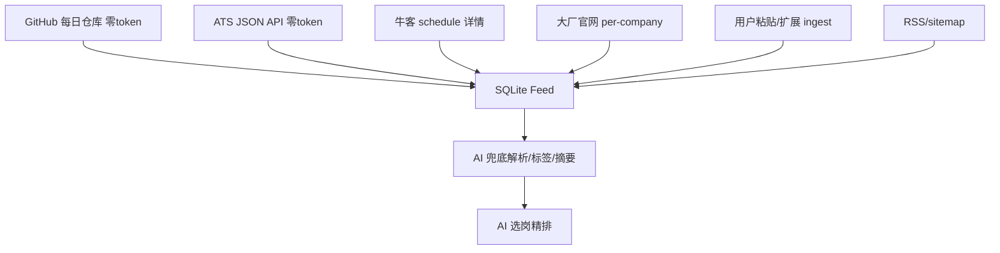

# ResumeAI v2 Brainstorm —— 数据源、AI 选岗、平台改造

> 目标：多且准的岗位 + 真正帮人投出去 + 合规高时效。参考 career-ops(54k★)、JobOps(3.3k★)、jobs-optima、AIHawk 与 GitHub 每日校招仓库。

---

## Part 0. 安全（务必先做）

- DeepSeek API Key 一旦在聊天/截图/commit 出现即视为泄露，**立刻在 DeepSeek 平台 rotate**。
- Key 只放 `backend/.env` 的 `DEEPSEEK_API_KEY=`（已被 .gitignore 忽略），永不硬编码、不贴对话、不进前端。

---

## Part 1. DeepSeek 能力边界（回答"发挥搜索能力"）

| 能力 | API 是否支持 | 说明 |
|------|-------------|------|
| Chat / JSON 输出 | ✅ | 现已用 |
| Function calling / tool calls | ✅ (V4) | 模型决定调哪个工具，**但函数由我们执行** |
| strict mode（JSON schema 校验） | ✅ Beta | 减少坏 JSON，建议开启 |
| thinking mode + tool | ✅ V3.2+ | 选岗精排可用 |
| **官方联网搜索** | ❌ | 模型不会自己上网；需自带 search 工具 |

**结论：** "DeepSeek 搜索"= DeepSeek 编排 + 我们提供搜索工具。落地形态见 Part 3「AI 选岗 Copilot」。

---

## Part 2. 数据源全面升级（多 + 准 + 合规 + 时效）

### 现状分层回顾

L1 高校 / L2 企业官网 / L3 聚合(牛客) / L4 公众号 → 慢、噪声、robots 误拦。

### 新增三类「零 Playwright / 高时效 / 合规」源

#### Tier S1：GitHub 每日校招仓库（强烈推荐，最高 ROI）

```
GitHub raw/API → 解析 markdown 表/JSON → 直接结构化入库
```

- 源：`SimplifyJobs/Summer2026-Internships`、`speedyapply/2026-SWE-College-Jobs`、
  `vanshb03/Summer2026-Internships`、`namewyf/Campus2026`、`SimplifyJobs/New-Grad-Positions`
- 优点：公开/MIT、专为消费、每日更新、含官方投递链接与内推码、零反爬
- 成本：HTTP GET + 正则/JSON 解析，**零 token、秒级**
- 合规：仓库本身即开放数据，遵守 LICENSE 即可

#### Tier S2：官方 ATS JSON API（借鉴 career-ops scan.mjs）

```
Greenhouse / Ashby / Lever 公开 JSON board API → 直接拿结构化职位
```

- 例：`boards-api.greenhouse.io/v1/boards/{company}/jobs`
- 优点：官方接口、字段干净（title/location/url/updated_at）、**零 token、零 Playwright**
- 适合外企/新势力；国内大厂仍走各自官网解析器（per-company parser）

#### Tier S3：官方 RSS / 站点地图（若有）

- 部分高校就业网/官网提供 RSS 或 sitemap.xml → 增量、低频、稳定

### 数据源优先级（新）



### 明确不做（合规红线）

- OfferShow（App+登录，无稳定公开页）
- 猎聘/BOSS/智联 列表爬（robots 禁止 + 反爬）
- 任何需要登录态/付费墙的内推星球

---

## Part 3. AI 选岗环节（核心诉求：帮人投对岗）

### 三层漏斗（token 从低到高）

| 层 | 方法 | 触发 | Token |
|----|------|------|-------|
| L0 规则粗排 | BM25+技能图谱+偏好(已有 match_engine) | 全量 | 0 |
| L1 AI 精排 | Top-K rerank + 理由(已有 ai_rerank_picks) | 前 15 | 1 次/天 |
| L2 选岗 Copilot | DeepSeek tool-calling 编排 | 用户提问 | 按需 |

### L2「选岗 Copilot」设计（发挥 DeepSeek tool calling）

给 DeepSeek 注册工具，让它根据用户偏好自己查 + 推理：

```
tools = [
  search_jobs(query, city, type),     # 查本地 SQLite feed（零外部）
  get_job_detail(job_id),             # 取 JD 全文
  match_resume(job_id),               # 调 match_engine 算分
  check_liveness(job_id),             # 岗位是否还开放
]
```

对话示例：「帮我挑北京 3 个最值得投的后端」→ DeepSeek 调 `search_jobs`→`match_resume`→
给出排序 + 每个岗位「为什么适合你 / 缺什么 / 截止时间」。

**省 token 要点**：工具返回结构化精简 JSON（非全文），只在最终一轮让模型总结。

### 借鉴 career-ops 的 Block G：岗位真实性检查

对每个 P0 岗位做「合法性分级」(真实/存疑/疑似 ghost job)，规则优先、AI 仅兜底。直接提升"挑出来的岗位准不准"。

---

## Part 4. 时效性 + 高效

| 问题 | 方案 |
|------|------|
| 全量 28min 太慢 | 已分「快速刷新(牛客+企业)」/「全量」；S1+S2 源拉取秒级 |
| 岗位过期 | liveness 检查 + `status=expired` tombstone（已有 last_seen_at） |
| 重复抓 | 内容 hash 缓存 + 增量 upsert（已有） |
| 调度 | 分 provider 错峰 cron（已有）；S1/S2 可高频(每 2–4h)，Playwright 源低频(每日) |

---

## Part 5. Google 产品思路全面改造

### 北极星指标（先定指标，再做功能）

> **不是"抓了多少岗位"，而是"用户单日完成 发现→改稿→投递 的闭环次数"。**

漏斗指标：曝光岗位 → 加入意向 → 一键改稿 → 导出 → 标记已投 → 回流(面试/offer)。

### 重新定位（差异化）

| 维度 | 本品护城河 |
|------|-----------|
| 垂直 | **中文校招/实习**（career-ops/JobOps 偏英文社招） |
| 真相源 | **知识库 + 母版简历**跨岗复用（非每次重写） |
| 人在回路 | 逐条 suggestion 确认（quality over quantity） |
| 闭环 | 岗位→改稿→导出→追踪→面试沉淀 一体 |

### 功能矩阵（对标 + 补齐）

| 能力 | career-ops | JobOps | 本品现状 | v2 建议 |
|------|-----------|--------|----------|---------|
| 多源聚合 | ✅ ATS API | ✅ 10+板 | ⚠️ 慢 | **加 S1/S2 零token源** |
| AI 选岗精排 | ✅ A-F | ✅ 0-100 | ✅ rerank | + 选岗 Copilot |
| 岗位真实性 | ✅ Block G | ⚠️ | ❌ | **加 legitimacy 分级** |
| 简历定制 | ✅ ATS PDF | ✅ | ✅ 强 | 保持优势 |
| 投递追踪 | ✅ | ✅ Gmail 自动 | ✅ | **+ 邮件自动识别状态** |
| 浏览器扩展 | ⚠️ | jobs-optima ✅ | ❌ | **一键抓 JD ingest** |
| 面试沉淀 | ✅ story bank | ⚠️ | ⚠️ mock | **STAR 故事库回流知识库** |
| 内推码 | ⚠️ | ❌ | ❌ | S1 仓库自带，**直接展示** |

### 三个「眼前一亮」的点子

1. **一键直达投递**：岗位卡 →「为此岗位改稿」→ 改完直接给官方投递链接 + 内推码，全程不跳出。
2. **每日求职简报**：早 8 点推「今日 3 个 P0 + 为什么 + 截止倒计时」，像 Google Now 卡片。
3. **浏览器扩展 ingest**：用户在任意官网 JD 页一键抓正文 → 进 ResumeAI（不爬列表，最合规，质量最高）。

### Google 式原则对照

| 原则 | 落地 |
|------|------|
| Focus on task | Hub 按"今天投什么"组织，弱化平行入口 |
| Speed | 零 token 源 + 缓存，刷新秒级 |
| Progressive disclosure | 高级筛选默认收起 |
| Trust/transparency | 每个推荐给"为什么"+合法性标 |
| Smart defaults | 偏好驱动 digest，越用越准 |

---

## Part 6. 落地路线（按 ROI 排序）

### 阶段 A（1–2 天，最高 ROI）
1. 接 **S1 GitHub 仓库 provider**（零 token、立即多+准+新）
2. 接 **S2 Greenhouse/Ashby/Lever JSON provider**（零 token）
3. 岗位卡展示**内推码 + 投递链接**

### 阶段 B（3–5 天）
4. **选岗 Copilot**：DeepSeek tool calling 编排
5. **岗位 legitimacy 分级**（Block G 思路）
6. liveness 检查接入列表

### 阶段 C（1–2 周）
7. **浏览器扩展** ingest JD
8. **邮件自动识别**投递状态（回流追踪）
9. 面试 STAR 故事库回流知识库
10. 每日简报推送

---

## Part 7. Token 成本估算（回答"会不会很耗"）

假设日增量 300 岗位、deepseek-v4-flash：

| 环节 | 调用 | 估算 |
|------|------|------|
| 抓取/发现 | 0（S1/S2/Playwright，无 LLM） | 0 token |
| 脏数据兜底解析 | 仅 weak ~30 条 / 批 10 | ~3 次 |
| 打标签摘要 | ok 批 20 | ~15 次 |
| 选岗精排 | Top15 | 1 次/天 |
| 选岗 Copilot | 用户主动 | 按需 |

→ 每日**几十次 flash 调用**，成本量级 ≈ 一杯水。**前提：AI 永不做抓取/翻页。**

---

## 一句话总结

> 多与准，靠的是 **GitHub 每日仓库 + 官方 ATS API（零 token）**；
> 帮人投，靠的是 **DeepSeek tool-calling 选岗 Copilot + 一键改稿直达投递**；
> 合规高效，靠的是 **官方接口/开放数据 + liveness/legitimacy 过滤**，把 Playwright 降为兜底。
