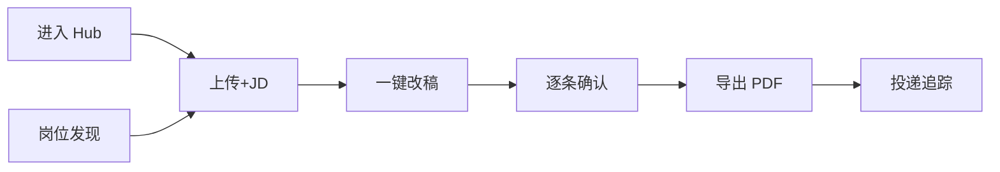

# ResumeAI 产品调研与优化建议

> 基于 Google 式「少即是多、人在回路、可解释 AI」产品思维 | 2026-06

## 1. 本品定位回顾

ResumeAI 核心差异：**知识库为真相源 + JD 为压缩目标 + 人逐条确认**，而非「上传即重写」。

主路径：工作台 → 准备(上传+JD) → 改稿(确认建议) → 导出 PDF → 追踪/岗位/面试。

---

## 2. 竞品 AI 简历/求职产品速览

| 产品 | 定位 | AI 用法亮点 | 付费/留存 |
|------|------|-------------|-----------|
| **Teal** | 求职 CRM + 简历 | Job Tracker 自动填表、简历关键词匹配 JD | Freemium，tracker 粘性 |
| **Jobscan** | ATS 关键词优化 | 扫描简历 vs JD 缺口，可解释打分 | 按次/订阅 |
| **Rezi** | AI 简历生成 | 一键生成 + ATS 分 | 模板订阅 |
| **Kickresume** | 模板 + AI 写作 | 段落级 AI 改写 | 模板市场 |
| **Final Round AI** | 面试 Copilot | 实时面试提示、模拟面试 | 面试场景订阅 |
| **LinkedIn Premium** | 人脉 + 岗位 | AI 撰写摘要、申请洞察 | 生态锁定 |
| **BOSS 直聘 AI** | 国内招聘 | JD 解读、智能打招呼 | 流量平台内嵌 |
| **脉脉** | 职场社交 | 内推、公司口碑 | 社交关系链 |

### 竞品共性

1. **闭环短**：看到 JD → 改简历 → 投递 → 追踪 在同一产品完成。
2. **可解释**：匹配分/关键词缺口可视化，用户知道「为什么改」。
3. **留存靠 tracker**：不是改完简历就走，而是持续管理 50+ 投递。
4. **Copilot 统一**：聊天入口能触发动作（筛选岗位、改简历、记笔记）。

### ResumeAI 相对优势

- 改稿质量与「人在回路」控制粒度（逐条 suggestion）
- 知识库跨岗位复用（母版简历 + STAR 素材）
- 混合匹配引擎（BM25 + 技能图谱）不依赖 embedding 成本
- 校招垂直数据源（高校 + 牛客 + 企业官网）

### ResumeAI 相对短板

- 岗位数据质量历史不稳定（本次爬虫优化已针对性改进）
- 改简历 → 投递闭环需用户手动跳转官方链接
- 无账号体系，跨设备同步弱
- Copilot 入口分散（改稿/知识库/岗位各一套，本次已统一输入组件与视觉）

---

## 3. Funnel 诊断

| 阶段 | 流失风险 | 建议 |
|------|----------|------|
| Hub | 不知下一步 | Continue 卡片强化「从岗位一键改稿」 |
| 准备 | JD 粘贴门槛 | 岗位页「改简历」已接 studio，可加 JD 预览 |
| 改稿 | 建议太多放弃 | 默认「安全可接受」批量 + 高亮 P0 缺口 |
| 导出 | 排版焦虑 | Finalize 门禁 + 布局检查已有，可加一页预览 diff |
| 追踪 | 懒得填 | 导出 PDF 已 auto-log，可弹窗补 channel/状态 |
| 岗位 | 噪声多 | weak 过滤 + AI 摘要 + P0 digest（已实现） |

---

## 4. 按价值/成本排序的改进建议

### 高价值 · 低成本（建议下一步）

1. **岗位 → 改稿一键闭环强化**  
   从 Jobs 进 studio 时自动带入 digest 的 `ai_summary` 作为 JD 补充上下文。

2. **Digest 推送**  
   浏览器通知或邮件：「今日新增 3 个 P0，字节/美团/阿里」。

3. **面试反馈沉淀知识库**  
   Mock interview 优秀回答一键写入 pending knowledge（部分已有规则提取，可加强）。

4. **统一 Copilot 命令面板**  
   Cmd+K 跨页面：「筛北京后端」「生成今日 digest」「打开上次改稿」。

### 中价值 · 中成本

5. **母版简历版本树**  
   同一 KB 产出多版 tailored resume，对比 diff。

6. **投递追踪与岗位 feed 联动**  
   已投公司自动进 blocklist，digest 降权。

7. **轻量账号**  
   邮箱 magic link 同步 client_id 数据（SQLite/JSON 已可按 client 隔离）。

### 高价值 · 高成本

8. **浏览器扩展一键抓 JD**  
   在 BOSS/官网 JD 页抓取正文进 ResumeAI（不爬列表，用户主动触发合规）。

9. **多模型路由**  
   解析/打标签用便宜模型，改稿用强模型。

10. **移动端只读 Hub**  
    看 digest + tracker，改稿仍桌面。

---

## 5. Google 产品思维对照

| 原则 | 现状 | 改进方向 |
|------|------|----------|
| **Focus on user task** | 功能多（KB/岗位/面试/洞察） | Hub 按任务聚合，减少平行入口 |
| **Progressive disclosure** | Studio 三步清晰 | 岗位页高级筛选默认收起 |
| **Consistent UI** | 曾有三套 copilot 样式 | 已统一 ChatInput + 语义色 token |
| **Trust through transparency** | 匹配有 radar/gap | digest 展示 AI 理由 + 规则分 |
| **Speed** | 一键改稿 pipeline | 步骤可并行（JD 分析 + 预读 KB） |

---

## 6. 总结

ResumeAI 的护城河在 **「可控的 AI 改稿 + 知识库复用 + 校招数据」**，而非纯聊天或纯模板。

近期交付（本次迭代）：

- 前端：多行自适应 ChatInput、设计 token 统一、移除失效飞书渠道  
- 后端：SQLite 岗位库、AI 门控批处理、牛客/高校源扩充、Digest AI 精排  

建议产品下一里程碑：**「岗位 Digest → 一键改稿 → 导出 → 追踪」单日闭环跑通率**，用 funnel 指标衡量，而非单纯功能数量。
